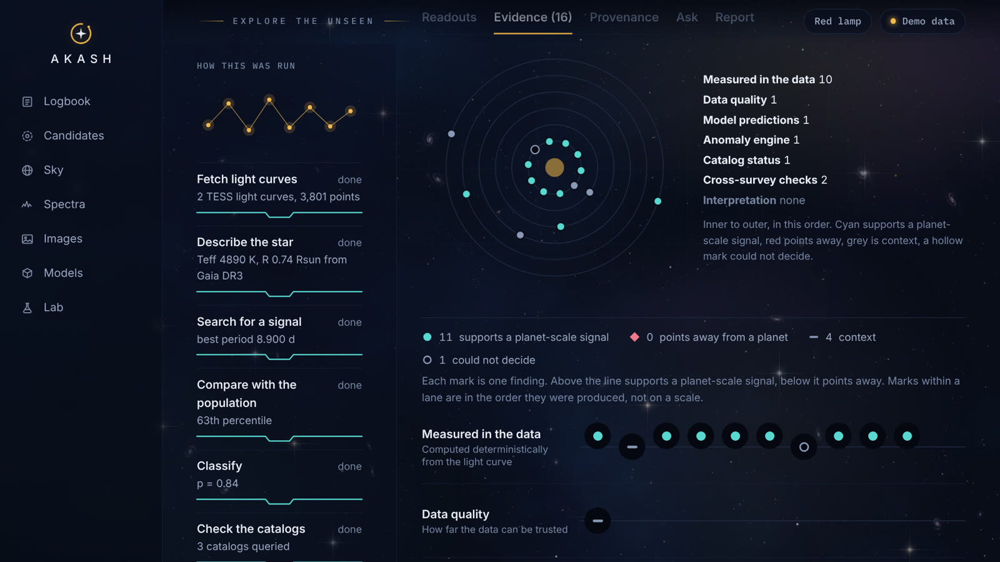
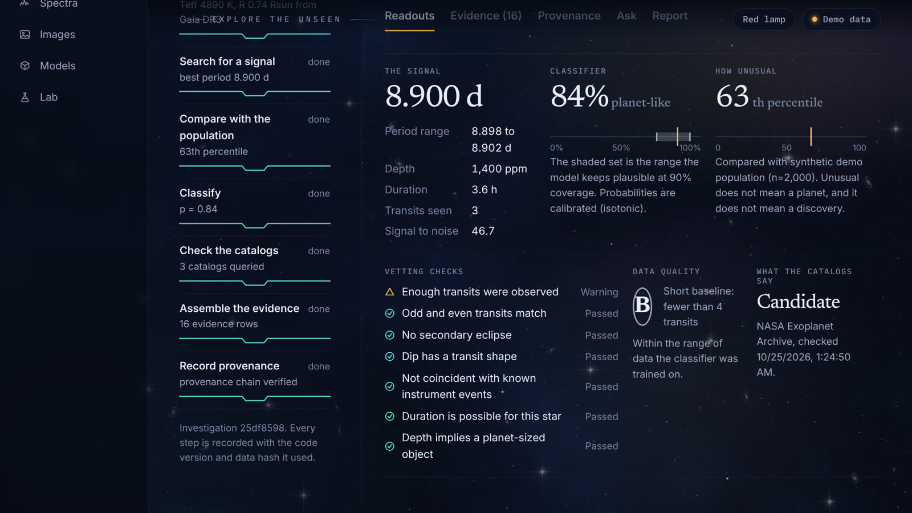
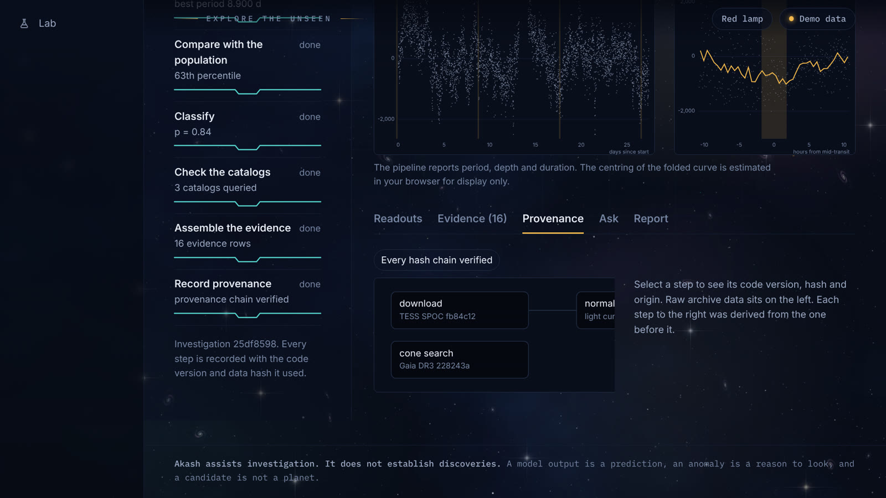

# AKASH: AI Astronomical Discovery Engine

> **Name a star. See what its light can and can't tell you.**

AKASH takes a star, fetches its real TESS or Kepler light curves, searches them for repeating dips,
checks every finding against the catalogs and Gaia, and keeps **each piece of evidence as its own
line**: measured facts, model predictions, anomaly scores, cross-survey checks and interpretation
never get blended into one number.

**AKASH assists investigation; it does not independently establish discoveries.** A model output is
a prediction, an anomaly is a reason to look, and a candidate is not a planet.



<sub>Screenshots use the built-in synthetic demo data (fake star IDs), not real discoveries.</sub>

## What it does

| | |
|---|---|
| **Investigate** | Resolve a name (SIMBAD, Gaia DR3, TIC/KIC), pull TESS/Kepler light curves from MAST, clean, detrend and run a box-least-squares search, then vet the signal. |
| **Evidence, not a score** | Readouts, vetting checks, classifier output, anomaly engine and catalog matches stay in separate channels, shown as an evidence ring and strip. |
| **Honest uncertainty** | Calibrated probabilities with conformal sets, out-of-distribution flags, and an explicit "could not decide" mark. |
| **Catalog and Gaia checks** | TOI/KOI/Exoplanet Archive matching by period, plus Gaia stellar parameters (Teff, radius, RUWE) and neighbour contamination. |
| **Provenance** | Every step records its code version and a content hash; the chain is verifiable end to end. |
| **Ask and Report** | A read-only research agent answers with citations (deterministic fallback, injection-hardened), and 13-section reports export as Markdown/HTML, built from stored evidence only. |
| **Triage** | A candidate queue with a published, fixed review order (no hidden score), filters, compare view and an all-sky map. |
| **Spectra and images** | Deterministic line/redshift candidates and galaxy photometry. |
| **Models and Lab** | A versioned model registry with model cards, and an injection-recovery lab that measures the pipeline's own sensitivity. |

<table><tr>
<td></td>
<td></td>
</tr></table>

## Real-data results

Run on live archives with `scripts/validate_real_targets.py` (details in
[docs/real-data-validation.md](docs/real-data-validation.md)):

| Target | Recovered | Result |
|---|---|---|
| WASP-18 b | 9970 ppm, SNR 389 | ok |
| pi Men c | 279 ppm, SNR 32 | ok, with Gaia stellar checks passing (R = 1.20 Rsun, RUWE 0.81) |
| TOI-270 c | 3596 ppm | ok (the hand-rounded reference is approximate) |
| Kepler-10 b | | Fixed after the first run: Kepler files name their quality column `SAP_QUALITY`. Covered by regression tests; **re-run to confirm on live data.** |

Four targets are a smoke test of the real-data path, not a measurement of false-positive or recall
rates.

## Quickstart

Requires Python 3.11+, [uv](https://docs.astral.sh/uv/) and Node 22+.

```bash
uv sync --all-packages --all-extras       # torch is an optional extra
cd frontend && npm install && cd ..
```

**Try it in demo mode (no backend, no keys):**

```bash
cd frontend && npm run dev                # http://localhost:5173
```

**Run it live against the real archives:**

```bash
# terminal 1: API
uv run uvicorn akash_api.main:app --port 8000
# terminal 2: one-off API key (shown once, stored hashed)
uv run python scripts/create_api_key.py --name me --role researcher
# terminal 3: frontend
cd frontend && npm run dev
```

In the app open Settings, switch off demo data, leave the API address empty and paste the key. The
key is kept per browser tab. On Windows, use the same commands in separate PowerShell windows and
add `--no-sync` to `uv run`.

Useful scripts: `scripts/diagnose_gaia.py` (check Gaia access end to end),
`scripts/validate_real_targets.py`, `scripts/injection_recovery.py`, `scripts/preflight.py`.

## Layout

- `packages/akash_core`: schemas, enums, ids, config (no web or ML dependencies)
- `packages/akash_data`: identity resolution, archive providers, caching, validation, ingestion
- `packages/akash_science`: deterministic light-curve science (quality, detrending, BLS, vetting)
- `packages/akash_ml`: transit classifier, calibration, conformal sets, OOD, anomaly engine, registry
- `packages/akash_fusion`: cross-survey evidence, triage rules, the investigation pipeline
- `packages/akash_agent`, `akash_report`, `akash_eval`: research agent, reports, experiment lab
- `packages/akash_provenance`: provenance records and lineage
- `services/api`: FastAPI service (thin routers)
- `frontend`: React + TypeScript observatory UI
- `docs/adr`: architecture decision records; `docs/deploy.md`: single-node deployment

## Quality gates

```bash
make lint && make typecheck && make test   # ruff, mypy --strict, pytest (offline)
make web-test && make web-build            # tsc, vitest, vite build
make live                                  # network tests against the real archives
```

CI runs the same checks on every push.

## Honest limits

- Most of the pipeline was developed and tested on **synthetic** light curves and in-memory fakes.
  Real-data coverage is the four-target run above.
- The trained classifier and anomaly reference are not shipped, so on a fresh install those report
  sections are empty rather than faked. Training scripts are in `scripts/`.
- No live LLM has been exercised for the research agent; the provider is tested against a mock
  transport and the deterministic fallback is the default.
- Single node only: SQLite and a local object store. Postgres and S3-style storage are not built.
- The Docker images are built by CI but have not been run by the author.
- The frontend is tested in Chromium only.
- Do not expose the live API publicly without reading [docs/deploy.md](docs/deploy.md): it queries
  real archives on your behalf.

See [docs/status.md](docs/status.md) for the full phase-by-phase record.

## License

[MIT](LICENSE)
